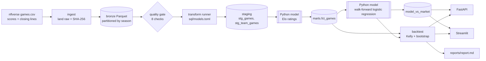

# EdgeIQ: an NFL model vs the betting market

A self-directed data engineering and analytics project. It ingests **every NFL game since 1999 with real closing betting lines** ([nflverse](https://github.com/nflverse/nfldata)), builds a tested Parquet + DuckDB warehouse, rates teams with point-in-time **Elo**, trains a **walk-forward** win-probability model, scores it against the market, and **backtests** betting its edges with Kelly sizing and bootstrap confidence intervals.

The question it answers honestly: *can a public-data model beat the closing line?* (On 20 years of real games: no. The numbers are below, and the result is as useful as a win would be.)

## Results (real data, 2006–2026, walk-forward)

From [`reports/report.md`](reports/report.md), regenerated weekly by CI:

| | Games | Log loss ↓ | Brier ↓ | Accuracy |
|---|---:|---:|---:|---:|
| **Market** (no-vig closing line) | 5,372 | **0.610** | **0.212** | **66.3%** |
| Model (logistic regression on Elo + context) | 5,372 | 0.630 | 0.220 | 64.0% |
| Elo alone | 5,372 | 0.630 | – | – |

| Backtest at closing odds | Bets | Flat-stake ROI | 95% CI | Quarter-Kelly bankroll |
|---|---:|---:|---|---|
| Bet the model's edges (≥3 pts) | 3,849 | −3.05% | −7.4% to +1.1% | $10,000 → $18 |
| Bet every home team | 5,373 | −4.30% | −7.1% to −1.6% | – |

What this shows:
- The closing line is **well calibrated**: games it prices around 75% are won 76% of the time; around 45%, 44%.
- The model beat the market's log loss in only 3 of 21 seasons (2006, 2015 and the partial 2026 season).
- The backtest's confidence interval includes zero: **no evidence of an edge**.
- Kelly sizing on an overconfident model is ruinous. Calibration has to come before sizing.

## Architecture



- **Lake:** `data/landing/` (raw files exactly as received) → `data/lake/bronze/games/season=YYYY/` (typed Parquet; each season partition is replaced on re-run, so loads are idempotent) → `_manifest.jsonl` (lineage: source, SHA-256, rows, seasons).
- **Warehouse:** DuckDB reading the lake. Models are declared in [`sql/models.toml`](sql/models.toml) and run by [`src/pipeline/transform.py`](src/pipeline/transform.py), a ~150-line runner that does what dbt does: `ref()` resolution with ordering checks, view/table materialization, SQL **and** Python models in one graph, and tests after every model that stop the build.
- **No look-ahead anywhere:** Elo rows hold the ratings *going into* each game; the model for season S is trained only on seasons before S (a test enforces it).

Details: [ARCHITECTURE.md](ARCHITECTURE.md) · [docs/DATA_DICTIONARY.md](docs/DATA_DICTIONARY.md)

## Quick start

```bash
make setup      # Python 3.11 venv + pinned dependencies
make demo       # whole pipeline on the synthetic sample (no network)
make run        # whole pipeline on real NFL data (downloads ~2 MB)
make test       # 81 tests incl. an end-to-end run
make dashboard  # http://localhost:8501
make api        # http://localhost:8000/docs
```

Each step can also run alone: `python -m src.cli ingest|check|build|backtest|report --source nflverse|sample`.

## How this was built

[docs/BUILD_GUIDE.md](docs/BUILD_GUIDE.md) is the step-by-step process from an empty folder: what to build in each phase, the commands, why, and how to check it's done. [docs/LESSONS.md](docs/LESSONS.md) lists the bugs that real data and the linter exposed, and how each was fixed.

## Quality

- **Bronze gate** (`src/pipeline/checks.py`): 8 checks; every one has a test that makes it fail on purpose.
- **Model tests** (`sql/models.toml`): uniqueness, ranges, no rows lost in joins, point-in-time training, and quarantine of impossible prices. Real data had one: a game whose two moneylines implied 98% total probability.
- **81 pytest tests**: ingestion, checks, Elo, walk-forward, runner, backtest math, API, odds parsing, plus the original engine tests.
- **CI:** lint + tests + demo on every push; a weekly job runs the full pipeline on fresh real data and publishes the report.

## Repository map

```
src/pipeline/     ingest (land + bronze), quality checks, transform runner
sql/              models.toml + staging/ and marts/ SQL
src/models/       elo.py, win_model.py (pipeline); game_predictor, player_projector, feature_engineering (library)
src/backtest/     strategy simulation, drawdown, bootstrap CI
src/engines/      EV + vig removal, Kelly sizing, CLV, correlated parlays (pure functions, tested)
src/api/          FastAPI: games, scores, backtest, and betting calculators
src/dashboard/    Streamlit app
src/ingestion/    live odds poller for The Odds API (library; paid key, not used by the pipeline)
src/intelligence/ injury-report parser (Claude API, optional) and contextual splits (library)
schema/           Postgres/TimescaleDB schema for the live system (design, not used by the pipeline)
data/sample/      synthetic games in nflverse's columns (tests, CI, `make demo`)
docs/             build guide, lessons, data dictionary, roadmap
```

## Limitations

- **Closing lines only.** nflverse has no opening odds, so closing line value (the standard proof of an edge) can't be measured here; the backtest bets at the close. The CLV engine is built and tested for when earlier prices are available.
- **Moneylines only** in the backtest (spreads and totals are in the data but not yet modeled).
- **Library modules not yet wired into the pipeline:** the live odds poller (paid API), the injury parser (paid LLM API), the player-prop projector and the parlay builder. They're tested as pure functions; [docs/ROADMAP.md](docs/ROADMAP.md) has the plan.
- The synthetic sample uses **fictional teams**; real runs use real games. Data © nflverse contributors, downloaded at run time and not redistributed here.

## Stack

Python 3.11 · pandas · PyArrow/Parquet · DuckDB · scikit-learn · FastAPI · Streamlit + Plotly · pytest · ruff · GitHub Actions
